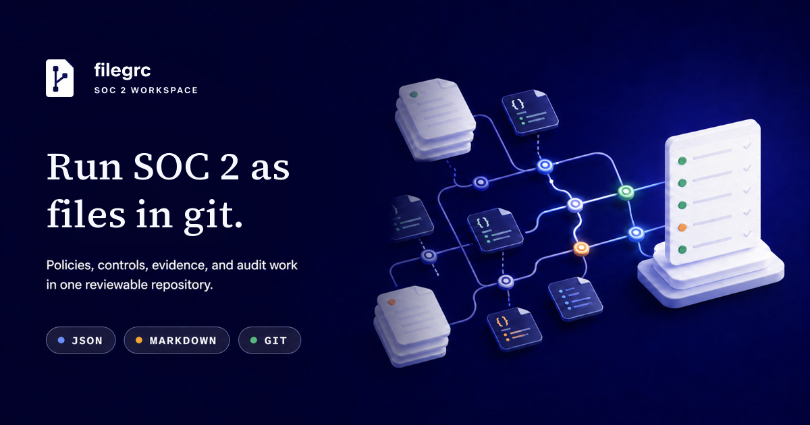
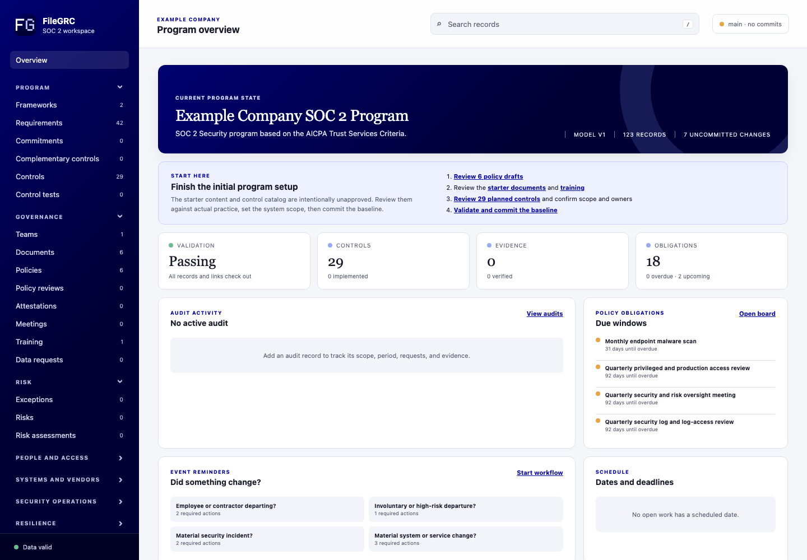

# FileGRC

[](https://filegrc.com)

Build and run your SOC 2 program with free software, files you own, and your own agents.

FileGRC is a Git-native GRC workspace for founders and engineers. Adopt policies, track control work, collect evidence, and prepare audit responses in one repository. The local software is free, open source, and [MIT licensed](https://github.com/Alignbase/filegrc/blob/main/LICENSE).

## Get started

```sh
npx create-filegrc@latest company-grc
cd company-grc
npm run validate
npm run serve
```

Requires Node.js 20 or newer and Git. Use a dedicated private repository for your program. Browser saves commit and push changes; agents and CLI users manage Git themselves.

## Your program, in files

JSON holds structured records. Markdown holds policies, procedures, and long-form work. Git supplies the change history, so you can review diffs, trace decisions, and retrieve earlier versions.

Use the local web app, your editor, or an agent. They work with the same files and validation rules. Your program stays readable and usable offline.

[](https://filegrc.com)

FileGRC guides you through scope, policy approval, control implementation, ongoing work, and audit preparation. Start with a Security-focused SOC 2 program, then expand when your scope calls for it. Starter records are proposals to review against how your company actually works.

## Give your agents the whole picture

An agent can inspect a policy, follow its linked controls and evidence, and check what the program needs next. Local files, model guides, and [machine-readable CLI output](https://github.com/Alignbase/filegrc/tree/main/packages/filegrc#readme) let it maintain records and work through tasks without navigating a browser.

Ask your agent to:

- Find the next setup task and carry it through validation.
- Prepare an access review using the current owners, scope, and evidence sources.
- Draft a security questionnaire response with sources for each answer and gaps clearly flagged.
- Assemble an audit evidence packet from the agreed scope and period.

The goal is a program running in days and supported responses in minutes. Actual timing depends on your scope, existing controls, current records, and accessible evidence. Human decisions and required reviews remain part of the work.

## Stay ready as the program runs

The Work Queue connects recurring reviews, policy events, owners, and deadlines. Readiness checks show missing work before an evidence period or audit, while evidence packets bring together records, attachments, Git history, and indexes.

[](https://filegrc.com)

Optional [FileGRC Autopilot](https://app.filegrc.com/guide) adds hosted owner reminders and policy-driven escalation when the local app is closed. The local software remains free; audit fees, source systems, and paid services are separate.

## Go deeper

Read the [workspace guide](https://github.com/Alignbase/filegrc/blob/main/packages/create-filegrc/template/AGENTS.md) for setup, Git, approvals, CLI workflows, and upgrades. Read the [record workflow guide](https://github.com/Alignbase/filegrc/blob/main/packages/create-filegrc/template/data/AGENTS.md) before changing program records. Browse the [data model](https://github.com/Alignbase/filegrc/blob/main/docs/data-model.md), or run `npx filegrc guide --json` to discover the installed commands and model.

FileGRC manages GRC records and audit evidence. Your infrastructure, identity, monitoring, endpoint, backup, and other source systems operate the controls and produce evidence. Keep secrets and personal data that may need erasure out of Git.

Your team performs the control work and reviews responses before submission. An independent CPA firm performs the SOC 2 examination, judges evidence sufficiency, and issues the report. Using FileGRC alone does not establish compliance.

[Learn more](https://filegrc.com) · [Source code](https://github.com/Alignbase/filegrc) · [Report an issue](https://github.com/Alignbase/filegrc/issues)
